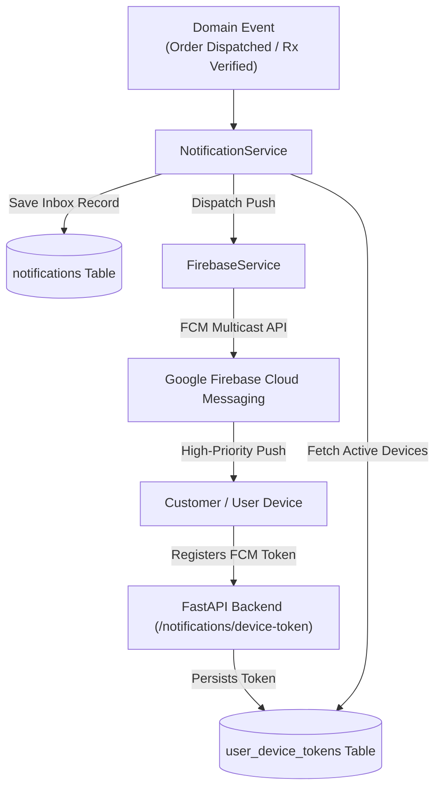
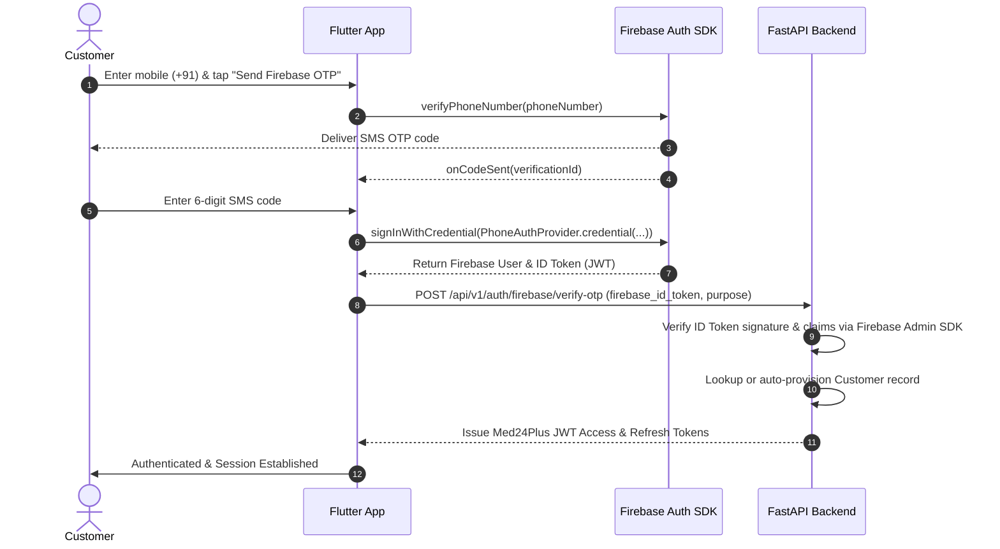

# Firebase Push Notifications (FCM) & Phone OTP Architecture

## 1. Overview & Provider Migration

Med24Plus previously planned integration with third-party SMS service providers (Msg91 / Fast2SMS) for OTP SMS dispatches. To enhance delivery reliability, security, multi-platform push capabilities, and eliminate third-party per-SMS carrier gateway costs, the system has transitioned to **Google Firebase**:

1. **Firebase Cloud Messaging (FCM)**: Replaces polling and handles transactional push notifications (order updates, prescription verification alerts, refill reminders, delivery progress).
2. **Firebase Phone Authentication**: Replaces external SMS gateways (Msg91 / Fast2SMS) for phone verification and password recovery with Google's native phone authentication infrastructure.
3. **Commented Service Provider Code**: The existing third-party SMS service provider dispatch logic has been commented out in:
   - `backend/app/services/otp_service.py`
   - `backend/app/core/config.py`
   - `backend/.env.example` & Root `.env.example`

---

## 2. Push Notification Architecture (FCM)



### 2.1 Database Schema: `user_device_tokens`

- **`id`** (`UUID`, Primary Key)
- **`user_id`** (`UUID`, Foreign Key to `users.id` with `CASCADE` delete)
- **`fcm_token`** (`VARCHAR(500)`, Unique index)
- **`device_type`** (`VARCHAR(50)`, e.g. `'android'`, `'ios'`, `'web'`)
- **`is_active`** (`BOOLEAN`, default `True`, indexed with `user_id`)
- **`last_used_at`** (`TIMESTAMP WITH TIME ZONE`)
- **`created_at`** / **`updated_at`** (`TIMESTAMP WITH TIME ZONE`)

### 2.2 Backend Services

1. **`app.services.firebase_service.FirebaseService`**:
   - Singleton managing Firebase Admin SDK initialization.
   - Automatically operates in safe simulation mode in local development/test environments when credentials are not yet loaded.
   - `send_push_notification(device_token, title, body, data)`: Dispatches single push alert.
   - `send_multicast_notification(device_tokens, title, body, data)`: Broadcasts to all user devices. Automatically identifies and flags unregistered/expired tokens.
   - `send_topic_notification(topic, title, body, data)`: Dispatches to topic subscribers.
2. **`app.services.notification_service.NotificationService`**:
   - Orchestrates inbox record persistence in PostgreSQL and triggers real-time FCM multicast dispatches.
   - Automatically cleans up deactivated/invalid device tokens reported by FCM.
3. **API Endpoints (`/api/v1/notifications`)**:
   - `POST /device-token`: Registers/renews user device FCM token.
   - `DELETE /device-token`: Deactivates FCM device token upon logout.
   - `GET /`: Retrieves paginated notification history and unread badge count.
   - `PUT /{notification_id}/read`: Marks notification as read.
   - `PUT /mark-all-read`: Marks all inbox notifications as read.
   - `POST /test-push`: Dispatches test notification to caller's registered devices.

---

## 3. Firebase Phone Auth & OTP Architecture



### 3.1 Backend Endpoints (`/api/v1/auth`)

- `POST /api/v1/auth/firebase/verify-otp`:
  - **Payload**:
    ```json
    {
      "firebase_id_token": "eyJhbGciOiJSUzI1NiIsImtpZCI6...",
      "purpose": "login", // or "phone_verification", "password_reset"
      "new_password": null,
      "confirm_password": null
    }
    ```
  - **Response**:
    ```json
    {
      "success": true,
      "message": "Authenticated successfully via Firebase Phone OTP.",
      "data": {
        "verified": true,
        "phone": "+919876543210",
        "tokens": {
          "access_token": "...",
          "refresh_token": "...",
          "token_type": "bearer",
          "expires_in": 900,
          "user": { ... }
        }
      }
    }
    ```

---

## 4. Mobile Client Implementation (Flutter)

### 4.1 Packages (`pubspec.yaml`)
- `firebase_core: ^3.12.0`
- `firebase_messaging: ^15.2.0`
- `firebase_auth: ^5.5.0`

### 4.2 Native Configurations
- **Android Gradle**:
  - `android/settings.gradle.kts`: Added `com.google.gms.google-services` plugin (`4.4.2`).
  - `android/app/build.gradle.kts`: Applied `com.google.gms.google-services`.
  - `android/app/google-services.json`: Configured with package `com.technosolz.med24plus`.
  - `android/app/src/main/AndroidManifest.xml`: Configured `POST_NOTIFICATIONS` permission and `med24plus_high_importance_channel`.

### 4.3 Flutter Services
1. **`PushNotificationService`** (`lib/core/services/push_notification_service.dart`):
   - Top-level `@pragma('vm:entry-point') firebaseMessagingBackgroundHandler`.
   - Requests user notification permissions.
   - Fetches FCM device token and registers with backend via `/notifications/device-token`.
   - Listens to token refreshes and background/foreground message events.
2. **`FirebaseAuthService`** (`lib/core/services/firebase_auth_service.dart`):
   - Formats Indian mobile numbers to E.164 (`+91XXXXXXXXXX`).
   - `sendPhoneOtp`: Calls `verifyPhoneNumber` with codeSent, verificationFailed, and auto-retrieval handlers.
   - `verifyOtpAndGetIdToken`: Validates SMS OTP code and retrieves signed Firebase ID token for backend authentication.
3. **`LoginScreen`** (`lib/features/auth/presentation/login_screen.dart`):
   - Added instant "Sign In with Firebase Phone OTP" modal bottom sheet.
