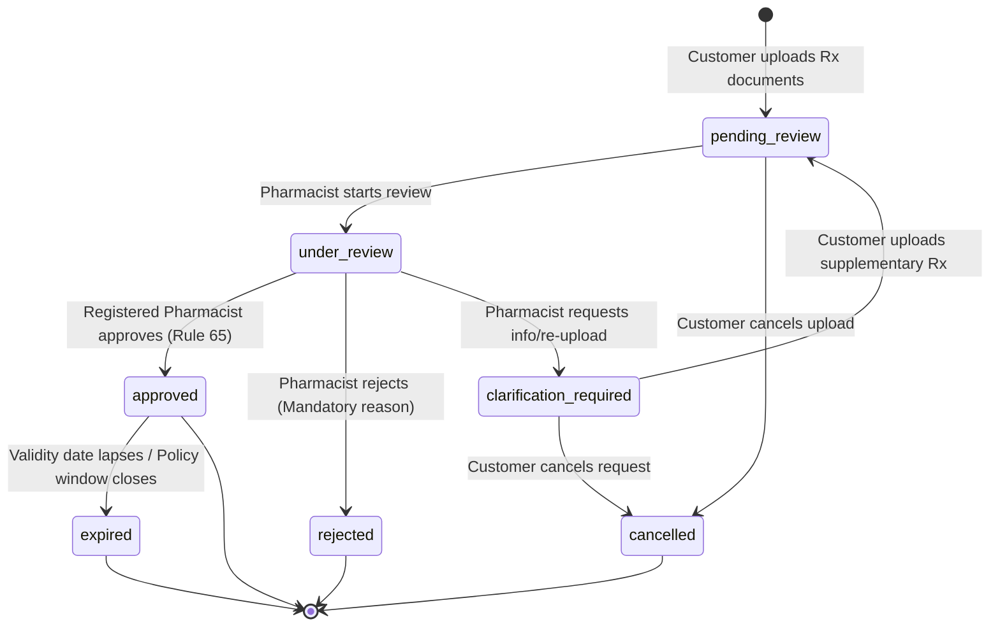

# Prescription Management & Pharmacist Workflows Architecture (Phase 6)

## 1. Overview & Regulatory Framework

Med24Plus operates as a licensed single-pharmacy digital platform in compliance with:
- **Drugs and Cosmetics Act, 1940 & Rules, 1945 (Rule 65)**: Mandating that medicines classified under Schedule H, Schedule H1, and Schedule X can only be dispensed on the valid prescription of a Registered Medical Practitioner (RMP). Dispensing verification must be executed by a qualified Registered Pharmacist.
- **Pharmacy Act, 1948**: Regulating the profession of pharmacy in India and state pharmacy council registrations.
- **Information Technology Act, 2000 & SPDI Rules, 2011**: Governing digital health records, sensitive personal data, and electronic record confidentiality.

---

## 2. Prescription Lifecycle State Machine



### 2.1 Permitted Transitions & State Rules

| Initial State | Allowed Target State | Trigger & Actor | Statutory / Business Rule |
| :--- | :--- | :--- | :--- |
| `pending_review` | `under_review` | Pharmacist opens verification | Locks Rx to prevent race conditions across pharmacist workbench. |
| `pending_review` | `cancelled` | Customer cancels upload | Permitted only if review hasn't progressed to decision. |
| `under_review` | `approved` | Pharmacist approval | Requires verified Registered Pharmacist (`is_verified=True`, registration number, state council). Creates immutable audit entry. |
| `under_review` | `rejected` | Pharmacist rejection | Requires mandatory statutory reason. Rejection is terminal. |
| `under_review` | `clarification_required` | Pharmacist clarification | Requires specific instructions (e.g. illegible doctor stamp, missing page 2). |
| `clarification_required` | `pending_review` | Customer re-upload | Patient attaches additional files or updated notes. Re-enters queue. |
| `clarification_required` | `cancelled` | Customer cancels upload | Customer elects not to proceed with clarification. |
| `approved` | `expired` | System policy scheduler | Prescription surpasses statutory validity period. |

---

## 3. Database Architecture & Alembic Migrations

### 3.1 Data Models

The prescription architecture separates files, line items, and audit logs into normalized tables:

1. **`prescriptions`** (`Prescription` model):
   - `id`: UUID (Primary Key).
   - `prescription_number`: Unique reference formatted as `RX-YYYYMM-XXXXXX`.
   - `customer_id`: Foreign key to `users.id` (Customer).
   - `status`: Enum (`pending_review`, `under_review`, `approved`, `rejected`, `clarification_required`, `expired`, `cancelled`).
   - `doctor_name`: Optional string.
   - `doctor_registration_number`: Optional string (RMP council registration).
   - `prescription_date`: Date written on the document by the doctor.
   - `valid_until`: Date until which dispensing is permitted.
   - `is_valid`: Boolean evaluation flag.
   - `invalidity_reason`: Text explanation if flagged invalid.
   - `customer_notes`: Initial notes or instructions provided by customer.
   - `pharmacist_notes`: Internal clinical/dispensing notes.
   - `rejection_reason`: Mandatory statutory explanation if rejected.
   - `clarification_remarks`: Instructions issued when clarification is sought.
   - Timestamps & actors: `uploaded_at`, `reviewed_at`, `reviewed_by_id`, `under_review_at`, `under_review_by_id`, `rejected_at`, `rejected_by_id`, `clarification_requested_at`, `clarification_requested_by_id`.

2. **`prescription_files`** (`PrescriptionFile` model):
   - `id`: UUID (Primary Key).
   - `prescription_id`: Foreign key to `prescriptions.id` (`ondelete="CASCADE"`).
   - `original_filename`: Original filename uploaded by user (sanitized).
   - `stored_filename`: Unique cryptographic key on disk.
   - `file_path`: Relative internal path under `private_storage/prescriptions/`.
   - `mime_type`: Validated MIME type (`image/jpeg`, `image/png`, `application/pdf`).
   - `file_size`: Size in bytes (strictly <= 10MB).
   - `checksum_sha256`: SHA-256 hash for document integrity and tamper detection.
   - `is_active`: Boolean flag.
   - `uploaded_at`: UTC timestamp.

3. **`prescription_review_logs`** (`PrescriptionReviewLog` model):
   - `id`: UUID (Primary Key).
   - `prescription_id`: Foreign key to `prescriptions.id`.
   - `pharmacist_id`: Foreign key to `users.id` (Reviewing Pharmacist).
   - `previous_status`: Previous status string.
   - `new_status`: New status string.
   - `decision`: Decision action enum/string.
   - `remarks`: Comments or statutory notes.
   - `created_at`: UTC timestamp (immutable).

4. **`prescription_items`** (`PrescriptionItem` model):
   - `id`: UUID (Primary Key).
   - `prescription_id`: Foreign key to `prescriptions.id`.
   - `product_id`: Optional foreign key to `products.id` (associated catalog medicine).
   - `medicine_name`: Medicine name as written on the doctor's prescription.
   - `dosage`: Dosage instructions (e.g., 500mg, 1 tab twice daily).
   - `quantity`: Quantity prescribed or requested.
   - `duration`: Duration of treatment.
   - `verification_status`: Status (`pending`, `verified`, `unavailable`, `rejected`).
   - `pharmacist_remarks`: Clinical notes regarding substitution or dispensing.

### 3.2 Alembic Migration
- **Revision ID**: `6c2d1e8a4f9b`
- **Down Revision**: `d5e6f7a8b9c0` (Phase 5 Inventory & FEFO)
- **File**: `alembic/versions/20261116_6c2d1e8a4f9b_phase6_prescription_management.py`
- Executed and active on PostgreSQL database.

---

## 4. Secure Private Storage Architecture

Prescription files contain sensitive health information (SPDI) and are never stored in public directories or served via unauthenticated endpoints.

### 4.1 Storage Directory Structure
```
med24plus/backend/private_storage/
└── prescriptions/
    └── 2026/
        └── 11/
            ├── 9c8b7a6d5e4f3a2b_page1.jpg
            ├── 1a2b3c4d5e6f7a8b_page2.png
            └── 4f5e6d7c8b9a0f1e_medical_record.pdf
```

### 4.2 Security & Validation Pipeline
1. **Filename Sanitization**: Strip dangerous characters, path traversal (`../`), null bytes, and non-ASCII glyphs.
2. **Magic Byte Content Inspection**:
   - `image/jpeg`: Header must begin with `\xff\xd8\xff`.
   - `image/png`: Header must begin with `\x89PNG\r\n\x1a\n`.
   - `application/pdf`: Header must begin with `%PDF-`.
   - Files with misleading extensions (e.g. `.exe` renamed to `.jpg`) are rejected immediately with HTTP 400.
3. **File Size Enforcement**: Maximum 10MB per document.
4. **Integrity Checksums**: SHA-256 hash calculated during upload and stored in `prescription_files.checksum_sha256`.
5. **Signed Access Tokens**:
   - Direct file URLs are never exposed.
   - Endpoints issue HMAC-SHA256 signed access tokens with a default 15-minute validity window.
   - Signature binds: `file_id`, `user_id`, `role`, and `expiration_timestamp`.
   - Streaming endpoints (`/api/v1/prescriptions/files/{file_id}/view` and `/download`) verify token signature, expiry, and user permissions before reading from disk.

---

## 5. Statutory Rule 65 Compliance & Pharmacist Verification

Under Drugs and Cosmetics Rules (Rule 65):
1. **Pharmacist Eligibility**: The reviewing user must hold the `PHARMACIST` role AND have an approved, verified `PharmacistProfile` (`is_verified == True`). Unverified staff cannot approve prescriptions.
2. **Prescription Validity Policy**:
   - Schedule X medicines: Valid for at most 30 days from date of issuance.
   - Schedule H and H1 medicines: Valid for up to 180 days (6 months).
   - Future prescription dates: Flagged as invalid immediately.
3. **Mandatory Rejection Reasons**: Pharmacists must state a statutory reason for any rejected prescription, which is permanently logged in the audit trail.
4. **Tamper-Evident Audit Logging**: Every state change writes an immutable row into `prescription_review_logs` and emits an event to the central `audit_logs` service.

---

## 6. API Endpoints

### 6.1 Customer Endpoints (`/api/v1/prescriptions`)
- `POST /api/v1/prescriptions`: Upload new prescription with multiple files (multipart/form-data).
- `GET /api/v1/prescriptions`: List own prescriptions (paginated with status filtering).
- `GET /api/v1/prescriptions/{id}`: Retrieve detailed prescription dossier with files, items, and history.
- `POST /api/v1/prescriptions/{id}/cancel`: Cancel a pending or clarification-requested prescription.
- `POST /api/v1/prescriptions/{id}/clarification-files`: Upload additional files in response to a pharmacist clarification request.
- `GET /api/v1/prescriptions/files/{file_id}/view`: Stream preview of prescription document using a valid signed token.
- `GET /api/v1/prescriptions/files/{file_id}/download`: Download prescription document with attachment headers.

### 6.2 Pharmacist Workbench Endpoints (`/api/v1/admin/prescriptions`)
- `GET /api/v1/admin/prescriptions/counts`: KPI metrics (pending, under review, clarification, approved, rejected, expired, total).
- `GET /api/v1/admin/prescriptions`: Filtered prescription queue with pagination.
- `GET /api/v1/admin/prescriptions/{id}`: Detailed prescription dossier for clinical review.
- `POST /api/v1/admin/prescriptions/{id}/start-review`: Lock prescription to current pharmacist (`under_review`).
- `POST /api/v1/admin/prescriptions/{id}/approve`: Approve prescription (validates Rule 65, RMP details, expiry date, pharmacist verification).
- `POST /api/v1/admin/prescriptions/{id}/reject`: Reject prescription with mandatory statutory reason.
- `POST /api/v1/admin/prescriptions/{id}/request-clarification`: Request clarification or supplementary documents from patient.
- `GET /api/v1/admin/prescriptions/{id}/history`: Retrieve immutable statutory review audit trail.
- `POST /api/v1/admin/prescriptions/{id}/items`: Extract and record prescribed medicine line items.

---

## 7. Frontend User Interfaces

### 7.1 Customer Web Application (`customer-web`)
- `/account/prescriptions`: Patient Prescription Vault displaying past and current prescriptions, status tags, upload dates, and direct links to details.
- `/account/prescriptions/[id]`: Detailed prescription status view, document viewer, review history, pharmacist remarks, and clarification upload form.
- `/prescription/upload`: Multi-file drag-and-drop prescription upload interface with preview, file removal, doctor details, and customer notes.

### 7.2 Admin & Pharmacist Workbench (`admin-panel`)
- `/prescriptions`: KPI queue overview cards, search by prescription number or patient, and status tabs (`pending_review`, `under_review`, `clarification_required`, `approved`, `rejected`).
- `/prescriptions/[id]`: Clinical verification workbench featuring:
  - High-resolution document viewer with pan/zoom and multi-page file switcher.
  - Patient health profile summary.
  - Statutory action buttons (Start Review, Approve Rx, Reject Rx, Request Clarification).
  - Medicine extraction panel for recording prescribed drugs and quantities.
  - Audit history timeline displaying all pharmacist actions and remarks.

